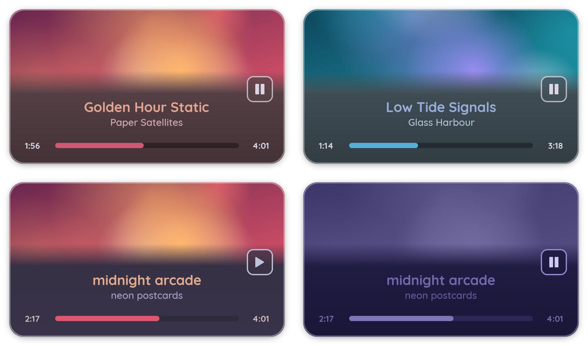

# Music Overlay

A small, borderless, always-on-top "now playing" card for Windows. Native WPF (.NET 10), no browser engine.
It uses about 0.5% of one CPU core while playing, ~0% while paused, and around 100 MB of private memory.



*Top: **Vivid**, which takes its accent colours from the album art. Bottom: **Classic** (fixed colours, lowercase text)
and **Dusk** (tinted). The screenshots use generated artwork and made-up tracks.*

## Install

```powershell
.\install.ps1
```

This builds the app, installs it to `%LOCALAPPDATA%\Programs\MusicOverlay`, sets it to **start with Windows**, and
launches it. Re-run it after pulling changes to update. `-NoStartup` installs without the startup entry, and `-Uninstall`
removes the app (settings in `%APPDATA%\MusicOverlay` are kept). You can also toggle startup from the right-click menu.

Requires the [.NET 10 SDK](https://dotnet.microsoft.com/download) and Windows 10 2004 or later.

For development: `dotnet run -c Release`.

## Use

| Action | How |
|---|---|
| Move | Drag anywhere on the card |
| Play / pause | Square button |
| Seek | Click the progress bar |
| Resize | Ctrl + mouse wheel, or right-click → Size |
| Appearance (theme, text case, size), opacity, sources, next/prev, lock, always-on-top, start with Windows, exit | Right-click the card |
| Show / hide, reset position, exit | Tray icon (left-click toggles) |

Themes: **Vivid** (accent colours pulled from the album art), **Dusk** (desaturated, purple-tinted),
**Auto** (Vivid while playing, Dusk while paused).

### Sources

Right-click → **Sources** lists every app Windows currently reports media for, such as Spotify or a browser playing
YouTube. Untick one to ignore it completely: the overlay acts as if that app doesn't exist, so a paused
Spotify still shows while a video plays. Blocked apps that aren't running are listed under "Unblock …".
**Prefer Spotify** picks Spotify when several apps are available. **Spotify only** ignores everything else.

**When nothing is playing** (right-click menu) decides what happens about 8 seconds after playback stops or pauses:
**Keep showing**, **Translucent** (fades to `IdleOpacity`, 35% by default; hover to bring it back), or **Hide**
(fades out, then hides). Blocked sources don't count as playing.

Settings are saved to `%APPDATA%\MusicOverlay\settings.json` (`BlockedSources`, `PreferredSource`,
`PreferredSourceOnly`, ...).

### Font

Quicksand (Regular/Medium/Bold, SIL OFL; licence in `Fonts/OFL.txt`) is bundled in `Fonts/` and copied to the output.
The `FontFamily` setting is the fallback list if those files are removed.

## Integrations

`WindowsMediaProvider` reads Windows' system media controls. That covers the Spotify desktop app with no API key
or login, plus browsers (YouTube, SoundCloud, web players), Apple Music, Tidal, VLC, and so on.

### Adding a new one

1. Create `Media/Providers/MyProvider.cs` implementing `IMediaProvider`:
   - Raise `StateChanged` with a `MediaState` (or `null`) whenever something changes. Any thread is fine.
   - Pass the same `Artwork` byte array again while the art is unchanged, so the UI doesn't re-decode it.
   - Report `Position` + `PositionTimestamp`. The UI extrapolates between updates, so there's no need to poll fast.
2. Add `yield return new MyProvider(settings);` in `Media/ProviderRegistry.cs`.

`MediaHub` picks automatically between providers: it sticks with the one that's playing, or switches to
whichever starts playing.

```
Media/
  IMediaProvider.cs      contract
  MediaState.cs          snapshot record
  MediaHub.cs            picks the active provider, routes commands
  ProviderRegistry.cs    list of enabled providers
  Providers/WindowsMediaProvider.cs
Theming/Palette.cs       Vivid/Dusk palettes + album-art colour extraction
MainWindow.xaml(.cs)     the card
App.xaml(.cs)            startup, tray icon, single instance
```

## Screenshots

The images in `docs/screenshots` are rendered offscreen, so there's no desktop capture or real album art in them:

```powershell
dotnet build -c Release
.\bin\Release\net10.0-windows10.0.19041.0\MusicOverlay.exe --snapshot docs\screenshots
```

## License

[MIT](LICENSE). The bundled Quicksand font is licensed under the SIL Open Font License (`Fonts/OFL.txt`).
